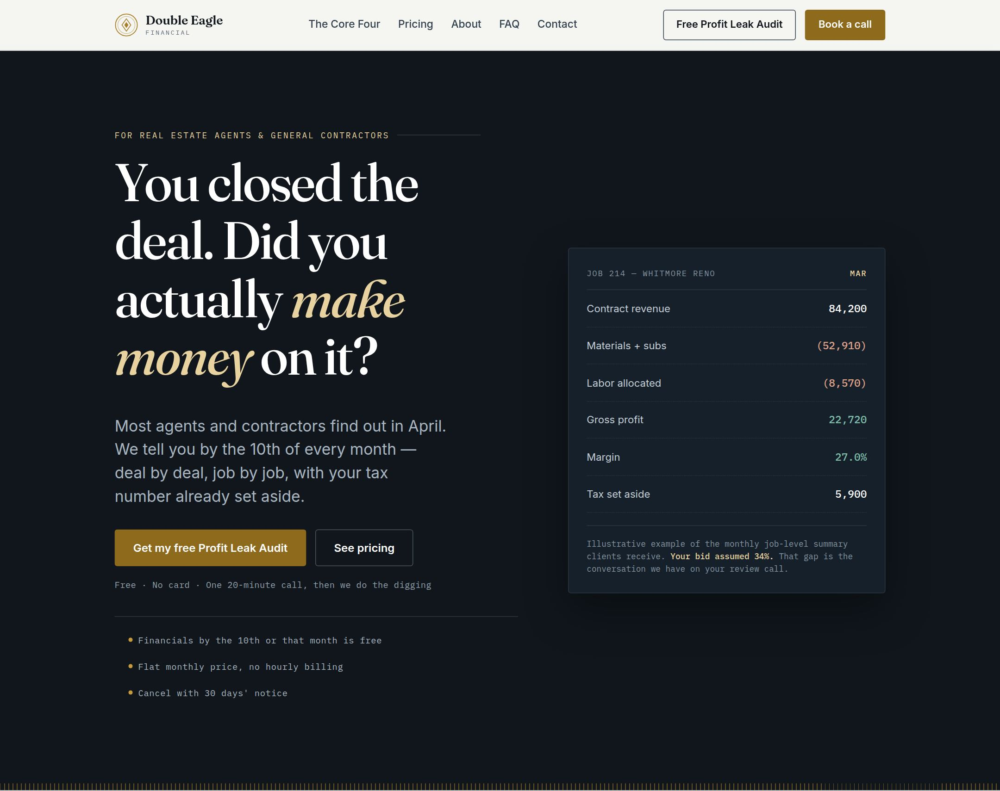
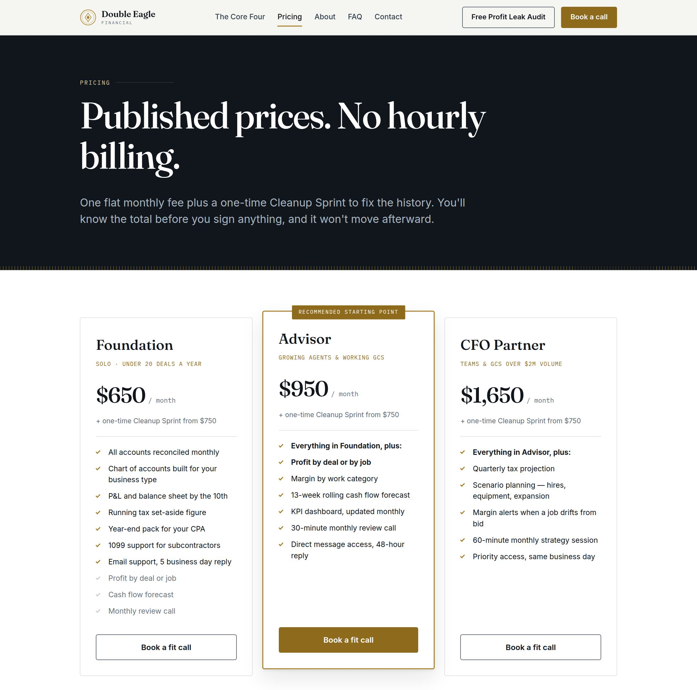
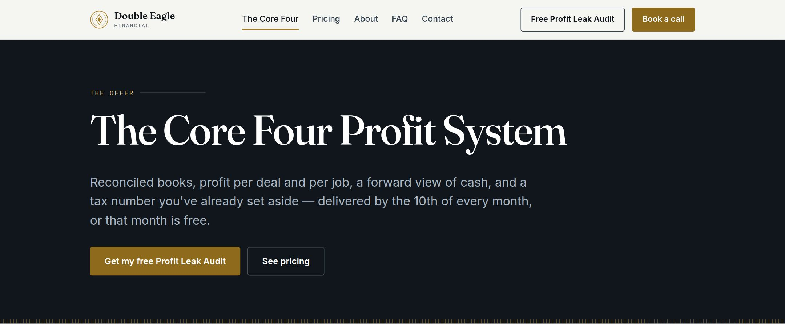
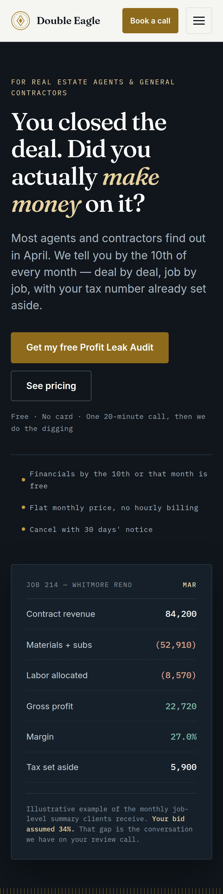

# Double Eagle Financial

Marketing site for Double Eagle Financial, a Memphis bookkeeping firm that works with real estate agents and general contractors.



The pages are static. There is no framework, package install, or build step. The HTML, CSS, and JavaScript in this repository are the site.

## Screenshots







## Where to open it

**On your machine.** From this directory:

```bash
python3 -m http.server 8080
```

Open [http://127.0.0.1:8080/](http://127.0.0.1:8080/). Start the server here, at the repository root. Links are root-relative (`/pricing.html`, `/assets/css/styles.css`), so opening the files from a subdirectory, or from the `file://` protocol, will not load the styles.

**Netlify, the primary host.** [https://doubleeaglefinancial.com](https://doubleeaglefinancial.com) and [https://www.doubleeaglefinancial.com](https://www.doubleeaglefinancial.com). Netlify publishes this repository from `main`, with no build command. It is not serving the site right now. On 3 November 2026 those addresses, and [https://doubleeaglefinancial.netlify.app](https://doubleeaglefinancial.netlify.app), returned Netlify's site-not-found page. DNS, response headers, the forms, and rollback are in [DEPLOYMENT.md](DEPLOYMENT.md).

**GitHub Pages, the backup host.** [https://ladariusjackson1.github.io/double-eagle-financial-site/](https://ladariusjackson1.github.io/double-eagle-financial-site/). A push to `main` runs [`.github/workflows/pages.yml`](.github/workflows/pages.yml). That workflow publishes a copy whose root-relative links are prefixed with `/double-eagle-financial-site`, which is what makes the styles and the page links work under a project URL. The files in the repository are not rewritten, so putting Netlify back does not take a second edit. Pages is already set to deploy from GitHub Actions.

## Checks

Every pull request, and every push to `main`, runs one job: [Validate HTML and check links](.github/workflows/check.yml).

- The [Nu Html Checker](https://validator.github.io/validator/) reads every HTML page. It fails the job on invalid markup. Footer column titles are `h4`, and a few in-page headings are `h3` directly under an `h1`, because `assets/css/styles.css` sizes those elements that way. That one message is ignored. Any other error fails the job.
- [lychee](https://github.com/lycheeverse/lychee) follows the links. Root-relative links are checked against the files in the repository, not against the Netlify domain, because that domain is down. Calendly, the Credly badges, the font stylesheet, and the other outside links are requested for real. The same check is run on the GitHub Pages copy, so a prefixed path that does not point at a file fails the job.

`scripts/check_site.sh` is that job. It needs Java, the Nu Html Checker jar, and lychee 0.24. The workflow installs the jar published as Nu 26.11.3 and lychee 0.24.2.

## Layout

```
index.html                 Home
the-core-four.html         The Core Four Profit System
pricing.html               Pricing
about.html                 About
faq.html                   FAQ
contact.html               Contact
book-a-call.html           Book a call
profit-leak-audit.html     Free Profit Leak Audit
thank-you.html             Form confirmation (noindex; blocked in robots.txt)
privacy.html               Privacy policy
terms.html                 Terms of service
sitemap.xml
robots.txt
assets/css/styles.css      All styles
assets/js/main.js          Navigation, forms, and analytics events
assets/js/config.js        Public form endpoint, booking link, and contact details
assets/img/                Favicon and Open Graph card
scripts/prepare_pages.py   Builds the GitHub Pages copy
scripts/check_site.sh      HTML validation and link check
```

The header, navigation, and footer are copied into each HTML file. A change to those has to be made on every page.

## Editing

- **Page copy.** Edit the HTML file for that page.
- **Styles.** Edit `assets/css/styles.css`. The token block at the top sets color, type, and spacing. `--brass` is decorative only (borders, rules, icons). `--brass-text` is the accessible color used for text and button fills.
- **Forms and booking.** `assets/js/config.js` holds the public Formspree endpoint and the Calendly link. It is served to every visitor, so it must not contain API keys or other secrets. Forms on the contact, Profit Leak Audit, and book-a-call pages POST JSON to `formEndpoint`. If that value is empty, the form shows a configuration error instead of pretending the message was sent.
- **Analytics.** `assets/js/main.js` pushes events onto `window.dataLayer`: `page_view`, `cta_click`, `book_a_call_click`, `lead_magnet_submit`, `booking_request_submit`, `contact_submit`, `lead_submit`, `lead_confirmed`, `faq_open`, `form_error`, and `form_submit_failed`. Set `window.DE_DEBUG = true` in the browser console to log them. `ga4MeasurementId` and `gtmContainerId` in `config.js` are optional and currently empty.

Canonical URLs, Open Graph tags, and `sitemap.xml` use `https://www.doubleeaglefinancial.com`.

Keep the root-relative links. Netlify and the local server both depend on the leading slash. The Pages script adds the project prefix only in the copy it publishes.
